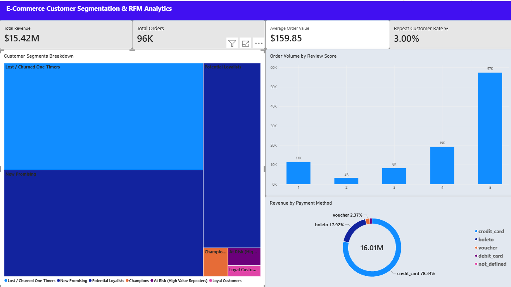

# E-Commerce Customer Segmentation & RFM Analytics Engine

An end-to-end data analytics project leveraging Brazilian E-Commerce data (Olist) to analyze transactional patterns, build RFM (Recency, Frequency, Monetary) behavioral clusters, and deliver an executive Power BI dashboard.



## 📌 Executive Summary
- **Total Revenue:** $15.42M across ~96K total delivered orders.
- **Average Order Value (AOV):** $159.85.
- **Repeat Customer Rate:** 3.00% (indicates an acquisition-driven marketplace with significant lifecycle retention potential).
- **Core Insight:** "Lost / Churned One-Timers" represent the vast majority of the customer base, highlighting that automated win-back triggers and loyalty incentives deliver higher long-term ROI than top-of-funnel acquisition alone.

## 🛠️ Tech Stack & Workflow
- **Data Ingestion & Transformation:** Python (`load_data.py`), PostgreSQL (`ecommerce_analytics`).
- **RFM Segmentation Engine:** SQL Views utilizing window functions (`NTILE`) to segment customers into actionable tiers.
- **Business Intelligence & Modeling:** Microsoft Power BI Desktop, Star Schema relational design.
- **DAX Calculations:** Dynamic KPI metrics, currency formatting, and cross-filtering interactions.

## 📊 Core DAX Calculations
```dax
Average Order Value = 
DIVIDE([Total Revenue], [Total Orders], 0)

Repeat Customer Rate % = 
VAR TotalCust = DISTINCTCOUNT(public_olist_customers[customer_unique_id])
VAR RepeatCust = 
    COUNTROWS(
        FILTER(
            VALUES(public_olist_customers[customer_unique_id]),
            CALCULATE(DISTINCTCOUNT(public_olist_orders[order_id])) > 1
        )
    )
RETURN
    DIVIDE(RepeatCust, TotalCust, 0)
```

## 📂 Repository Structure
```text
ecommerce-rfm-analytics/
├── dashboard/
│   ├── olist_rfm_customer_dashboard.pbix
│   └── dashboard_preview.png
├── dax/
│   └── measures.dax
├── sql/
│   └── rfm_segmentation.sql
├── .gitignore
└── README.md
```

## 🚀 How to Run Locally
1. Download the raw data from [Kaggle Brazilian E-Commerce (Olist)](https://www.kaggle.com/datasets/olistbr/brazilian-ecommerce).
2. Execute the ingestion and SQL scripts to initialize the database schema and RFM views.
3. Open `dashboard/olist_rfm_customer_dashboard.pbix` in Microsoft Power BI Desktop.